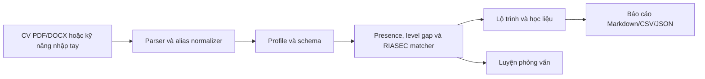

# AI Career Coach

[](.python-version)
[](https://streamlit.io/)
[](Dockerfile)
[](https://github.com/LinhLaSieuSao/AI-Career-Coach/actions/workflows/ci.yml)
[](tests/)
[](LICENSE)

AI Career Coach là ứng dụng Streamlit chạy local để đối chiếu kỹ năng với yêu cầu nghề, lập lộ trình học và luyện phỏng vấn. Bản hiện tại dùng quy tắc và dữ liệu trong repo; tên sản phẩm không hàm ý có mô hình AI hay LLM đang chấm điểm.


## Bài toán

Tên kỹ năng trong CV và mô tả công việc (JD) thường khác nhau, khiến người học khó biết mình đã có gì và cần học gì. Ứng dụng hỗ trợ tự rà soát và định hướng học tập, không dự đoán khả năng trúng tuyển. CV được xử lý trong phiên Streamlit, không có chức năng lưu CV vào cơ sở dữ liệu hay gọi API bên thứ ba. Khi triển khai trên máy chủ, người vận hành cần đánh giá riêng quyền riêng tư của môi trường đó.

## Kiến trúc



[Mô tả kiến trúc và giới hạn dữ liệu](docs/architecture.md) · [Hợp đồng giao diện](docs/interface.md)

## Cơ chế lõi

- `skill_extractor.py` so khớp cụm từ và alias trong `data/skill_aliases.json`; RapidFuzz chỉ hỗ trợ lỗi chính tả gần đúng trong văn bản CV. Người dùng rà soát các kỹ năng trước khi xác nhận.
- Presence score đo phần kỹ năng role đã nhận diện theo trọng số. Gap theo level dùng mức 0–3 do người dùng khai báo; app yêu cầu xác nhận trước khi coi level chưa khai báo là 0 cho lần tính.
- Điểm gợi ý role kết hợp **75% skill fit + 25% RIASEC interest fit**. Khi skill fit dưới **15%**, điểm tổng bị chặn ở **5/100**. Đây là heuristic để khám phá role, không phải xác suất tuyển dụng.
- JD được tách nhóm bắt buộc/ưu tiên khi tiêu đề rõ ràng; người dùng xác nhận lại kỹ năng được trích trước khi đối chiếu.

## Giới hạn và độ tin cậy

PDF scan không có OCR; CV tối đa 10 MiB và PDF chỉ đọc 10 trang đầu. Học liệu có trạng thái review, nguồn và phạm vi level riêng; URL mở được không chứng minh nội dung phù hợp. Câu hỏi và đáp án phỏng vấn là khung tham khảo tự đánh giá, **không chấm điểm tự động**. Dữ liệu nghề, học liệu và đáp án còn cần rà soát chuyên môn và quyền phân phối; xem [LICENSES.md](LICENSES.md).

## Dữ liệu

Catalog hiện có **131 vị trí**, chia thành **15 nhóm nghề**. Ngân hàng **766 câu hỏi** nằm trong **10 phân hệ** ở `data/interview_questions/`. `data/roles.json`, `skill_catalog.json`, `skill_aliases.json`, `resources.json`, `interests.json` và `role_families_riasec.json` là dữ liệu mà web đang dùng; ba hồ sơ minh họa tổng hợp ở `demo_profiles.json`.

## Cấu trúc repo

```text
app.py                     Streamlit UI
assets/                    style.css, site.js
modules/                   schemas, catalog, parser, extractor, profile,
                           matcher, recommender, interview, export
data/                      role, skill, RIASEC, resource và question catalogs
scripts/check_links.py     kiểm tra URL học liệu khi cần
tests/                     unit tests và Streamlit AppTest
docs/                      architecture, interface, demo, pof-checklist, screenshots
.github/workflows/ci.yml   pytest, lint, Docker health và secret check
requirements.lock          một tập phiên bản có hash cho local, CI và Docker
```

## Chạy ứng dụng

Cần Docker hoặc Python **3.12**. Với Docker:

```bash
docker compose up --build
```

Mở `http://localhost:8501`. Với local trên Windows:

```powershell
py -3.12 -m venv .venv
.\.venv\Scripts\python.exe -m pip install --require-hashes -r requirements.lock
.\.venv\Scripts\python.exe -m streamlit run app.py
```

Trên macOS/Linux thay hai lệnh đầu bằng `python3.12 -m venv .venv` và `.venv/bin/python -m pip install --require-hashes -r requirements.lock`, rồi chạy `.venv/bin/python -m streamlit run app.py`.

`requirements.txt` liệt kê thư viện web, `requirements-dev.txt` thêm pytest/ruff, `requirements-ai.txt` dành cho mở rộng sau này. Lock duy nhất chứa cả runtime và công cụ kiểm thử để ba môi trường dùng cùng phiên bản.

## Kiểm thử và CI

Chạy `python -m pytest -q tests/`. CI chạy tám file test và Docker health check, đồng thời quét tên file nhạy cảm trong từng layer image. Bước Ruff hiện chỉ báo thông tin để nhóm xử lý dần các cảnh báo cũ.

## Nhóm, demo và giấy phép

| Phần | Phụ trách |
| --- | --- |
| Dữ liệu, matching, roadmap, phỏng vấn, link | [A] |
| Schema, dependencies, CI/Docker, kiến trúc | [B] |
| Streamlit UI, hồ sơ, export, demo | [C] |

[Kịch bản demo](docs/demo.md) · [Checklist PoF](docs/pof-checklist.md) · [MIT License](LICENSE) · [Đóng góp](CONTRIBUTING.md) · [GitHub Discussions](https://github.com/LinhLaSieuSao/AI-Career-Coach/discussions). Video và slide có thể gắn tại đây khi nhóm phát hành.
