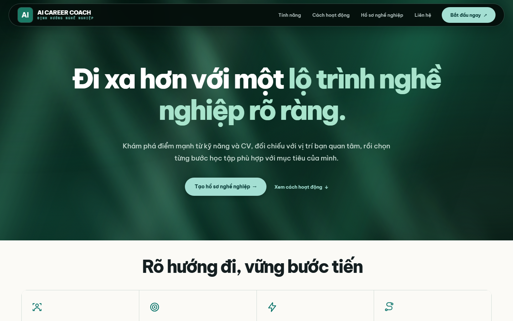
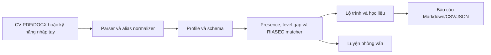

# AI Career Coach

[](.python-version)
[](https://streamlit.io/)
[](Dockerfile)
[](https://github.com/LinhLaSieuSao/AI-Career-Coach/actions/workflows/ci.yml)
[](tests/)
[](LICENSE)

AI Career Coach là ứng dụng Streamlit chạy local để đối chiếu kỹ năng với yêu cầu nghề, lập lộ trình học và luyện phỏng vấn. Phần phỏng vấn có thể nhận nhận xét từ LLM do người dùng cấu hình; nếu không có key hoặc dịch vụ lỗi, ứng dụng chấm gần đúng theo từ khóa rubric. Các phần khác dùng quy tắc và dữ liệu trong repo.



## Bài toán

Tên kỹ năng trong CV và mô tả công việc (JD) thường khác nhau, khiến người học khó biết mình đã có gì và cần học gì. Ứng dụng hỗ trợ tự rà soát và định hướng học tập, không dự đoán khả năng trúng tuyển. CV được xử lý trong phiên Streamlit và không bao giờ gửi tới LLM. Khi cấu hình LLM cho phỏng vấn, chỉ nội dung câu hỏi, rubric, red flags và câu trả lời được gửi tới nhà cung cấp đã chọn. Khi triển khai trên máy chủ, người vận hành cần đánh giá riêng quyền riêng tư của môi trường đó.

## Kiến trúc



[Mô tả kiến trúc và giới hạn dữ liệu](docs/architecture.md) · [Hợp đồng giao diện](docs/interface.md)

## Cơ chế lõi

- `skill_extractor.py` so khớp cụm từ và alias trong `data/skill_aliases.json`; RapidFuzz chỉ hỗ trợ lỗi chính tả gần đúng trong văn bản CV. Người dùng rà soát các kỹ năng trước khi xác nhận.
- Presence score đo phần kỹ năng role đã nhận diện theo trọng số. Gap theo level dùng mức 0–3 do người dùng khai báo; app yêu cầu xác nhận trước khi coi level chưa khai báo là 0 cho lần tính.
- Điểm gợi ý role kết hợp **75% skill fit + 25% RIASEC interest fit**. Khi skill fit dưới **15%**, điểm tổng bị chặn ở **5/100**. Đây là heuristic để khám phá role, không phải xác suất tuyển dụng.
- JD được tách nhóm bắt buộc/ưu tiên khi tiêu đề rõ ràng; người dùng xác nhận lại kỹ năng được trích trước khi đối chiếu.

## Giới hạn và độ tin cậy

PDF scan không có OCR; CV tối đa 10 MiB và PDF chỉ đọc 10 trang đầu. Học liệu có trạng thái review, nguồn và phạm vi level riêng; URL mở được không chứng minh nội dung phù hợp. Điểm phỏng vấn đo mức đạt rubric, chỉ mang tính tham khảo; chấm offline theo từ khóa là ước lượng thô. Dữ liệu nghề, học liệu và đáp án còn cần rà soát chuyên môn và quyền phân phối; xem [LICENSES.md](LICENSES.md).

## Dữ liệu

Catalog hiện có **131 vị trí**, chia thành **15 nhóm nghề**. Ngân hàng **766 câu hỏi** nằm trong **10 phân hệ** ở `data/interview_questions/`. `data/roles.json`, `skill_catalog.json`, `skill_aliases.json`, `resources.json`, `academic_curriculum.json`, `interests.json` và `role_families_riasec.json` là dữ liệu mà web đang dùng; lớp academic curriculum nối giáo trình/học liệu và kế hoạch thực hành theo từng kỹ năng mà không thay đổi lịch sử review tài liệu gốc. Ba hồ sơ minh họa tổng hợp ở `demo_profiles.json`.

## Cấu trúc repo

```text
app.py                     Streamlit UI
assets/                    style.css, site.js
modules/                   schemas, catalog, parser, extractor, profile,
                           matcher, recommender, interview, export
data/                      role, skill, RIASEC, resource và question catalogs
scripts/check_links.py     kiểm tra URL học liệu khi cần
tests/                     unit tests và Streamlit AppTest
docs/                      architecture, interface, demo, pof-checklist, screenshots
.github/workflows/ci.yml   pytest, lint, Docker health và secret check
requirements.lock          một tập phiên bản có hash cho local, CI và Docker
```

## Chạy ứng dụng

Cần Docker hoặc Python **3.12**. Với Docker:

```bash
docker compose up --build
```

Mở `http://localhost:8501`. Với local trên Windows:

```powershell
py -3.12 -m venv .venv
.\.venv\Scripts\python.exe -m pip install --require-hashes -r requirements.lock
.\.venv\Scripts\python.exe -m streamlit run app.py
```

Trên macOS/Linux thay hai lệnh đầu bằng `python3.12 -m venv .venv` và `.venv/bin/python -m pip install --require-hashes -r requirements.lock`, rồi chạy `.venv/bin/python -m streamlit run app.py`.

## Bật nhận xét AI

- Trong phần **Luyện phỏng vấn**, chọn **Tự đánh giá theo tiêu chí** để đối chiếu từ khóa với rubric mà không cần key hoặc gửi câu trả lời tới LLM. Cách này không đánh giá đầy đủ ý nghĩa câu trả lời.
- Để **Nhận góp ý từ AI**, đăng nhập [Groq Console](https://console.groq.com/), tạo key tại [API Keys](https://console.groq.com/keys) và dán vào ô API key Groq trên trang. Key thuộc tài khoản của người dùng, không đưa vào repo; hạn mức và chi phí tùy tài khoản. Câu hỏi, tiêu chí và câu trả lời được gửi tới Groq; không nhập thông tin nhạy cảm.
- Key được giữ trong phiên ứng dụng. Không gửi key qua chat, chia sẻ key hoặc đưa key vào mã nguồn. Ứng dụng gọi `openai/gpt-oss-120b` qua API Groq; cần quyền sử dụng mô hình này trên tài khoản Groq.

Nếu dịch vụ AI lỗi, ứng dụng ghi rõ kết quả dự phòng chỉ đối chiếu từ khóa, không phải nhận xét của LLM. Tối đa 20 lượt nhận xét qua LLM trong một phiên; câu trả lời được cắt còn 3.000 ký tự trước khi gửi. Module vẫn hỗ trợ cấu hình API và Ollama cho các tích hợp khác; giao diện web hai chế độ sử dụng key Groq do người dùng nhập.

`requirements.txt` liệt kê thư viện web, `requirements-dev.txt` thêm pytest/ruff, `requirements-ai.txt` dành cho mở rộng sau này. Lock duy nhất chứa cả runtime và công cụ kiểm thử để ba môi trường dùng cùng phiên bản.

## Kiểm thử và CI

Sau khi cài thư viện như hướng dẫn ở trên, chạy nhanh kiểm thử và mở web trên máy:

```bash
python scripts/demo_smoke.py
```

Script báo kết quả pytest, sau đó mở website ngay cả khi có bài kiểm thử thất bại để có thể kiểm tra thủ công. Giữ terminal mở khi dùng web và nhấn Ctrl+C để dừng. Dùng `--test-only` để chỉ chạy kiểm thử hoặc `--web-only` để chỉ mở web; thêm `--no-browser` nếu muốn tự mở địa chỉ được in ra. Website chỉ mở trên máy đang chạy script. Thử chức năng AI cần key Groq hợp lệ và kết nối mạng; kiểm thử tự động không đảm bảo chất lượng nhận xét AI thực tế.

Có thể chạy riêng `python -m pytest -q tests/`. CI chạy tám file test và Docker health check, đồng thời quét tên file nhạy cảm trong từng layer image. Bước Ruff hiện chỉ báo thông tin để nhóm xử lý dần các cảnh báo cũ.

## Nhóm, demo và giấy phép

| Phần | Phụ trách |
| --- | --- |
| Dữ liệu, matching, roadmap, phỏng vấn, link | [A] |
| Schema, dependencies, CI/Docker, kiến trúc | [B] |
| Streamlit UI, hồ sơ, export, demo | [C] |

[Kịch bản demo](docs/demo.md) · [Checklist PoF](docs/pof-checklist.md) · [MIT License](LICENSE) · [Đóng góp](CONTRIBUTING.md) · [GitHub Discussions](https://github.com/LinhLaSieuSao/AI-Career-Coach/discussions). Video và slide có thể gắn tại đây khi nhóm phát hành.
