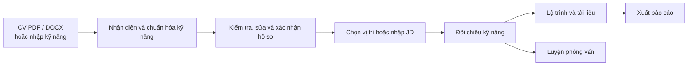

# AI Career Coach

[](.python-version)
[](https://streamlit.io/)
[](https://github.com/LinhLaSieuSao/AI-Career-Coach/actions/workflows/ci.yml)
[](LICENSE)

> Từ CV, kỹ năng và vị trí bạn quan tâm, AI Career Coach giúp bạn nhìn lại mình đã có gì, còn thiếu gì và có thể bắt đầu học từ đâu.

Đây là ứng dụng web viết bằng Python và Streamlit. Phần lớn chức năng chạy bằng quy tắc và dữ liệu có sẵn trong repo, không cần API key. Riêng phần góp ý câu trả lời phỏng vấn có thêm lựa chọn dùng LLM.

---

## 1. Dự án giải quyết vấn đề gì?

Khi đọc một bản mô tả công việc, không phải lúc nào người học cũng dễ biết mình đã đáp ứng đến đâu. Cùng một kỹ năng có thể được gọi bằng nhiều tên; CV lại thường không nói rõ mức độ thành thạo. Ngay cả khi đã thấy phần còn thiếu, việc chọn tài liệu và sắp xếp thứ tự học vẫn mất thời gian.

AI Career Coach gom những bước đó vào một luồng: tạo hồ sơ, đối chiếu với vị trí hoặc JD, xem khoảng cách kỹ năng rồi tìm tài liệu và luyện phỏng vấn. Dự án hiện có danh mục **131 vị trí thuộc 15 nhóm ngành**, cùng dữ liệu học liệu, câu hỏi và hồ sơ mẫu để trải nghiệm.

Điểm số trong ứng dụng là kết quả đối chiếu theo quy tắc của dự án. Chúng không phải xác suất trúng tuyển hay chứng nhận năng lực. Người dùng vẫn cần kiểm tra kỹ năng được nhận diện và tự cân nhắc kết quả.

---

## 2. Ứng dụng hoạt động như thế nào?



| Phần | Bạn có thể làm gì? |
| --- | --- |
| **Hồ sơ** | Tải CV PDF/DOCX, nhập kỹ năng thủ công hoặc chọn hồ sơ mẫu; sửa lại kết quả nhận diện và tự khai báo level. |
| **Gợi ý nghề** | Xem các vị trí gợi ý dựa trên kỹ năng và sở thích RIASEC. |
| **Khoảng cách kỹ năng** | So sánh hồ sơ với yêu cầu của vị trí hoặc các kỹ năng nhận diện được trong JD. |
| **Lộ trình và tài liệu** | Xem các kỹ năng cần bổ sung, học liệu, bài thực hành và kế hoạch học theo dữ liệu có sẵn. |
| **Phỏng vấn** | Chọn câu hỏi theo vị trí, trả lời và nhận góp ý theo rubric bằng cách đối chiếu từ khóa hoặc dùng LLM. |
| **Xuất báo cáo** | Tải kết quả dưới dạng Markdown, CSV hoặc JSON. |

Sau khi xác nhận hồ sơ, kết quả được trình bày trong năm tab: **Tóm tắt**, **Khoảng cách**, **Lộ trình**, **Tài liệu** và **Phỏng vấn**.

---

## 3. Cách tính kết quả

### Nhận diện kỹ năng và so khớp

Ứng dụng tìm kỹ năng trong CV hoặc JD dựa trên danh mục, các tên tương đương và so khớp chuỗi gần đúng. Kết quả có thể bỏ sót hoặc nhận nhầm, nhất là khi văn bản có cách diễn đạt khác với dữ liệu trong repo. Vì vậy, bước kiểm tra và xác nhận hồ sơ là cần thiết. Ứng dụng không tự suy ra level từ CV.

Với vị trí trong danh mục, điểm khớp cho biết mức bao phủ các kỹ năng theo trọng số của vị trí. Khoảng cách theo level là một phép tính riêng, dựa trên mức 0–3 do người dùng khai báo. Nếu chưa khai báo đủ, ứng dụng yêu cầu xác nhận trước khi tính các level còn thiếu là 0.

Với JD, ứng dụng thử nhận diện và chia kỹ năng thành nhóm bắt buộc, ưu tiên hoặc chưa phân loại. Khi hai nhóm đầu đã được xác nhận, chỉ số bao phủ tổng hợp dùng tỷ lệ **85% bắt buộc / 15% ưu tiên**; nhóm chưa phân loại được hiển thị riêng. Cách chia dựa trên cấu trúc và từ khóa trong JD nên cần được rà soát lại.

### Gợi ý vị trí

Điểm gợi ý kết hợp **75% mức khớp kỹ năng** và **25% mức phù hợp sở thích**. Khi mức khớp kỹ năng dưới 15%, điểm tổng bị giới hạn ở 5/100. Quy tắc này giúp tránh xếp hạng cao chỉ nhờ sở thích, nhưng không có nghĩa người dùng không phù hợp với nghề đó.

### Lộ trình và phỏng vấn

Lộ trình được tạo từ khoảng cách kỹ năng và học liệu trong `data/`. Khi nguồn không có thời lượng đủ căn cứ, ứng dụng không tự gán số tuần. Nội dung học và câu hỏi có trạng thái rà soát khác nhau; nhãn review nội bộ không đồng nghĩa với thẩm định độc lập của chuyên gia.

Phần phỏng vấn đối chiếu câu trả lời với rubric. Chế độ tự đánh giá dùng từ khóa; chế độ AI gửi câu hỏi, tiêu chí và câu trả lời tới dịch vụ LLM. Cả hai đều có thể nhận xét sai, nên điểm chỉ phù hợp để tham khảo khi luyện tập.

---

## 4. Cài đặt và chạy

### Docker

Cần có Docker và Docker Compose. Mở terminal tại thư mục `AI-Career-Coach-hoan-chinh`:

```bash
docker compose up --build
```

Mở [http://localhost:8501](http://localhost:8501). Nhấn `Ctrl+C` để dừng.

### Python trên Windows

Dự án yêu cầu **Python 3.12**. Tại thư mục dự án, chạy trong PowerShell:

```powershell
py -3.12 -m venv .venv
.\.venv\Scripts\python.exe -m pip install --require-hashes -r requirements.lock
.\.venv\Scripts\python.exe -m streamlit run app.py
```

### Python trên macOS/Linux

```bash
python3.12 -m venv .venv
.venv/bin/python -m pip install --require-hashes -r requirements.lock
.venv/bin/python -m streamlit run app.py
```

Mở địa chỉ Streamlit hiển thị trong terminal. Để thử nhanh, chọn một hồ sơ mẫu, kiểm tra kỹ năng, xác nhận hồ sơ rồi chọn vị trí hoặc nhập JD. [Kịch bản demo](docs/demo.md) hướng dẫn chi tiết hơn.

### Bật góp ý phỏng vấn bằng AI

Chế độ tự đánh giá không cần key. Nếu muốn dùng AI, tạo key tại [Groq Console](https://console.groq.com/keys), chọn **Nhận góp ý từ AI** trong giao diện và nhập key. Giao diện gọi model `openai/gpt-oss-120b`; cần kết nối mạng và quyền sử dụng, hạn mức hoặc chi phí phụ thuộc vào tài khoản Groq.

Key được giữ trong phiên ứng dụng. Khi dùng chế độ này, câu hỏi, rubric và tối đa 3.000 ký tự câu trả lời được gửi tới Groq; CV và hồ sơ không nằm trong request đó. Không đưa thông tin nhạy cảm vào câu trả lời hoặc chia sẻ key công khai. Khi dịch vụ lỗi hoặc đạt giới hạn 20 lượt gọi LLM trong phiên, ứng dụng chuyển sang đối chiếu từ khóa và thông báo trên giao diện.

Module phỏng vấn cũng hỗ trợ cấu hình endpoint tương thích OpenAI qua các biến trong [.env.example](.env.example). Giao diện hiện dùng key Groq được nhập trực tiếp.

---

## 5. Dữ liệu và cấu trúc repo

```text
.
├── app.py                        Giao diện Streamlit và luồng ứng dụng
├── modules/
│   ├── cv_parser.py              Đọc CV PDF/DOCX
│   ├── skill_extractor.py        Nhận diện và chuẩn hóa kỹ năng
│   ├── profile.py, schemas.py    Hồ sơ và cấu trúc dữ liệu
│   ├── matcher.py                Đối chiếu vị trí, JD và gợi ý nghề
│   ├── recommender.py            Xây dựng lộ trình, học liệu
│   ├── curriculum.py             Ghép nội dung giáo trình
│   ├── interview.py              Câu hỏi và nhận xét phỏng vấn
│   └── export.py                 Xuất báo cáo
├── data/
│   ├── roles.json                Danh mục vị trí và kỹ năng
│   ├── skill_catalog.json        Danh mục kỹ năng
│   ├── skill_aliases.json        Các tên kỹ năng tương đương
│   ├── interests.json            Dữ liệu sở thích
│   ├── role_families_riasec.json  Nhóm nghề và RIASEC
│   ├── resources.json            Học liệu
│   ├── academic_curriculum.json  Giáo trình và bài thực hành
│   ├── demo_profiles.json        Hồ sơ mẫu tổng hợp
│   └── interview_questions/      Ngân hàng câu hỏi theo nhóm nghề
├── assets/, brand_assets/        Tài nguyên giao diện và nhận diện
├── components/ui/                Thành phần React/TypeScript tham khảo
├── scripts/                      Công cụ demo và kiểm tra dữ liệu
├── tests/                        Kiểm thử module và giao diện
├── docs/                         Kiến trúc, hợp đồng module và demo
├── requirements.lock             Dependency cố định cho Docker/CI
├── Dockerfile
└── docker-compose.yml
```

Các thành phần React/TypeScript trong `components/ui/` là mã tham khảo; ứng dụng Streamlit hiện không build chúng. Nguồn và ghi chú về quyền sử dụng dữ liệu, học liệu được tổng hợp tại [LICENSES.md](LICENSES.md).

---

## 6. Giới hạn và dữ liệu cá nhân

- **CV:** Mỗi tệp tối đa 10 MiB; PDF chỉ đọc tối đa 10 trang đầu. PDF scan không có lớp văn bản chưa được hỗ trợ OCR.
- **Danh mục:** Kỹ năng hoặc cách diễn đạt ngoài dữ liệu của dự án có thể không được nhận diện. Việc không nhận diện được không có nghĩa người dùng không có kỹ năng đó.
- **Học liệu:** Một số nguồn bằng tiếng Anh; link còn hoạt động không đảm bảo nội dung phù hợp hoặc đầy đủ. Với luật, thuế, y tế và an toàn, cần đối chiếu nguồn Việt Nam hiện hành và người có chuyên môn.
- **Dữ liệu phiên:** Hồ sơ và kết quả được giữ trong phiên Streamlit; ứng dụng không lưu CV vào cơ sở dữ liệu và không tự khôi phục phiên khi mất trạng thái. Báo cáo xuất không chứa toàn văn CV nhưng có thể chứa thông tin hồ sơ và kỹ năng.
- **Triển khai:** Khi chạy trên máy chủ, dữ liệu được xử lý trong môi trường máy chủ đó. Cần kiểm tra chính sách truy cập và vận hành trước khi dùng dữ liệu thật.

---

## 7. Kiểm thử và đóng góp

Sau khi cài dependency, chạy bộ kiểm thử:

```bash
python -m pytest -q tests/
```

Để chạy kiểm thử qua công cụ demo, dùng `python scripts/demo_smoke.py --test-only`. Bỏ `--test-only` nếu muốn công cụ mở ứng dụng để kiểm tra thủ công; thêm `--no-browser` nếu muốn tự mở trình duyệt. CI được cấu hình chạy test, build Docker và kiểm tra health của container. Kiểm thử tự động không thay thế việc rà soát chuyên môn đối với học liệu, câu hỏi và nhận xét AI.

Nếu muốn sửa mã hoặc bổ sung dữ liệu, xem [CONTRIBUTING.md](CONTRIBUTING.md). Khi thêm kỹ năng, câu hỏi hay học liệu, hãy giữ nguồn rõ ràng, dùng dữ liệu hồ sơ tổng hợp để kiểm thử và ghi đúng trạng thái rà soát.

---

## 8. Tài liệu và giấy phép

| Tài liệu | Nội dung |
| --- | --- |
| [Kiến trúc](docs/architecture.md) | Các thành phần và luồng dữ liệu. |
| [Hợp đồng giao diện](docs/interface.md) | Đầu vào, đầu ra và giới hạn của các module. |
| [Kịch bản demo](docs/demo.md) | Các bước thử ứng dụng với hồ sơ mẫu. |
| [Checklist PoF](docs/pof-checklist.md) | Phạm vi xác minh của đề tài. |
| [Changelog](CHANGELOG.md) | Lịch sử thay đổi. |
| [Nguồn và quyền sử dụng](LICENSES.md) | Ghi chú về dữ liệu và học liệu. |

Mã nguồn được phát hành theo [MIT License](LICENSE). Cấu trúc trình bày có tham khảo [Vietnam Data Job Market Analysis](https://github.com/BhunZ/Vietnam-Data-Job-Market-Analysis).
