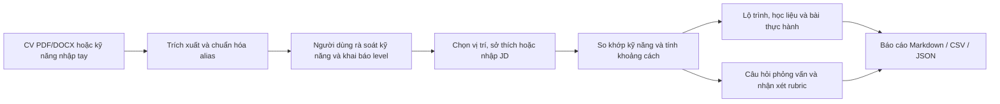

# AI Career Coach

[](.python-version)
[](https://streamlit.io/)
[](https://github.com/LinhLaSieuSao/AI-Career-Coach/actions/workflows/ci.yml)
[](LICENSE)

AI Career Coach là web Streamlit giúp người học đối chiếu kỹ năng với một vị trí nghề nghiệp, tìm khoảng cách cần học, xem học liệu và luyện phỏng vấn. Phần hồ sơ, gợi ý nghề và lộ trình dựa trên quy tắc cùng dữ liệu trong repo. Riêng câu trả lời phỏng vấn có thể được nhận xét bằng LLM khi người dùng tự cấu hình dịch vụ; không có cấu hình vẫn dùng được chế độ chấm rubric offline.

## 1. Vấn đề

Một kỹ năng có thể xuất hiện dưới nhiều tên trong CV, mô tả công việc (JD) và danh mục nghề. Người học vì thế khó biết mình đã có kỹ năng nào, còn thiếu gì so với vị trí quan tâm và nên học theo thứ tự nào. Một danh sách khóa học đơn thuần cũng không cho biết phải thực hành ra sao hoặc bằng chứng nào cho thấy mình đã tiến bộ.

Ứng dụng hỗ trợ **tự rà soát và lập kế hoạch học**. Điểm số trong web là chỉ báo theo quy tắc, không phải xác suất được tuyển dụng hay chứng nhận năng lực.

## 2. Giải pháp

Từ CV PDF/DOCX hoặc kỹ năng nhập tay, web trích và chuẩn hóa tên kỹ năng, cho người dùng sửa kết quả rồi đối chiếu với yêu cầu vị trí hoặc JD. Kết quả gồm kỹ năng đã có, khoảng cách theo mức thành thạo, lộ trình học, tài liệu và câu hỏi phỏng vấn. Người dùng xác nhận kỹ năng trước khi đánh giá và khai báo level khi muốn xem khoảng cách theo mức thành thạo.

Ba điểm thiết kế chính:

- **Có thể chạy không cần API key:** matching, lộ trình và nhận xét phỏng vấn offline hoạt động bằng dữ liệu trong repo.
- **Học đi cùng thực hành:** lớp `academic_curriculum.json` nối học liệu nền tảng, phạm vi học, các bước luyện tập và đầu ra để xin phản hồi cho 410 kỹ năng trong danh mục nghề.
- **Nêu rõ căn cứ và giới hạn:** web phân biệt tài liệu đã review, tài liệu chỉ bao phủ một phần, thời lượng chưa biết và điểm rubric tham khảo.

## 3. Luồng project



Web có hai bước nhập liệu trước khi hiện năm tab kết quả: **Tóm tắt → Khoảng cách → Lộ trình → Tài liệu → Phỏng vấn**. Người dùng có thể bắt đầu nhanh bằng một trong ba hồ sơ tổng hợp ở `data/demo_profiles.json`; các hồ sơ này không mô tả người thật.

## 4. Kết quả demo và giao diện

Kịch bản offline sẵn có trong [`scripts/demo_smoke.py`](scripts/demo_smoke.py) nhập một CV và JD tổng hợp cho vị trí **Data Analyst**, khai báo level, tạo câu hỏi phỏng vấn rồi gửi câu trả lời mẫu. Lần kiểm tra tích hợp đã cho kết quả:

| Bước | Kết quả quan sát được |
| --- | --- |
| Nhập hồ sơ | Nhận diện được SQL, Python, Excel và Power BI từ dữ liệu mẫu. |
| Đối chiếu JD | Khớp **4/4 kỹ năng bắt buộc** trong JD mẫu. |
| Lộ trình | Tab lộ trình hiển thị học liệu và bước học cho khoảng cách kỹ năng. |
| Phỏng vấn | Tạo câu hỏi và trả nhận xét rubric offline; điểm phụ thuộc câu hỏi được chọn, không phải điểm tuyển dụng. |
| Riêng tư trong demo | Kịch bản chặn mọi request ra ngoài và xác nhận không gửi CV hay câu trả lời lên mạng. |

Năm tab có nhiệm vụ khác nhau:

| Tab | Người dùng xem hoặc làm gì? |
| --- | --- |
| **Tóm tắt** | Xem hồ sơ đã xác nhận, mức khớp kỹ năng và gợi ý vị trí. |
| **Khoảng cách** | So sánh kỹ năng hiện có với yêu cầu vị trí, kể cả chênh lệch level 0–3. |
| **Lộ trình** | Xem thứ tự học, tài liệu nền tảng, bài thực hành và thời lượng khi có căn cứ. |
| **Tài liệu** | Mở nguồn học, xem phạm vi, trạng thái review và tài liệu thực hành bổ sung. |
| **Phỏng vấn** | Tạo bộ câu hỏi, gửi câu trả lời, xem từng ý rubric đạt/chưa đạt và gợi ý cải thiện. |

[Kịch bản trình diễn khoảng 7 phút](docs/demo.md) mô tả thứ tự thao tác trên giao diện hiện tại.

## 5. Tính năng

| Nhóm | Khả năng hiện có |
| --- | --- |
| **Đầu vào** | CV PDF/DOCX tối đa 10 MiB, kỹ năng nhập tay, kinh nghiệm, sở thích, JD và ba hồ sơ mẫu. PDF chỉ đọc tối đa 10 trang đầu. |
| **Trích kỹ năng** | So khớp cụm từ và alias; RapidFuzz hỗ trợ lỗi chính tả gần đúng. Người dùng có thể thêm, bỏ và xác nhận kỹ năng. |
| **Đối chiếu vị trí** | Presence score theo trọng số kỹ năng; khoảng cách theo level tự khai báo 0–3. |
| **Gợi ý nghề** | Kết hợp 75% skill fit với 25% RIASEC interest fit; khi skill fit dưới 15%, điểm tổng bị chặn ở 5/100. |
| **Đối chiếu JD** | Tách kỹ năng bắt buộc/ưu tiên khi JD có tiêu đề rõ và cho rà soát lại kỹ năng được trích. |
| **Lộ trình và học liệu** | Danh mục 131 vị trí; giáo trình/học liệu nền tảng cho 410 kỹ năng, kèm bước học, bài thực hành và đầu ra. Không tự đặt số tuần khi nguồn không có thời lượng đáng tin. |
| **Phỏng vấn** | Ngân hàng 766 câu hỏi trong 10 phân hệ; nhận xét theo rubric bằng LLM tùy chọn hoặc bằng so khớp từ khóa offline. |
| **Xuất kết quả** | Báo cáo Markdown, CSV hoặc JSON; không xuất toàn văn CV. |

## 6. Cách hoạt động

`modules/cv_parser.py` đọc CV; `modules/skill_extractor.py` dùng `data/skill_aliases.json` để chuẩn hóa kỹ năng. `modules/profile.py` tạo hồ sơ đã xác nhận. `modules/matcher.py` tính presence, khoảng cách level và gợi ý vị trí; `modules/recommender.py` lập lộ trình từ dữ liệu tài liệu đã ghép với `modules/curriculum.py`. `modules/interview.py` chọn câu hỏi và nhận xét câu trả lời. `app.py` nối các bước này với giao diện Streamlit.

Điểm presence phản ánh phần kỹ năng của vị trí đã nhận diện theo trọng số. Điểm theo level dùng mức 0–3 người dùng tự khai báo; app yêu cầu xác nhận trước khi coi level chưa khai báo là 0 cho lần tính. Cả hai đều là phép đối chiếu với catalog, không đo khả năng làm việc ngoài thực tế.

Học liệu có trạng thái và phạm vi review riêng. Lớp giáo trình học thuật bổ sung kiến thức nền và bài tập mà không sửa lịch sử review của nguồn cũ. Đọc xong tài liệu không đồng nghĩa đã đạt level. Với tài liệu không công bố thời lượng, lộ trình trình bày thứ tự học thay vì bịa số tuần hoàn thành.

Sau khi gửi câu trả lời phỏng vấn, mã ứng dụng tính điểm từ các tiêu chí rubric. Khi có LLM, dịch vụ trả nhận xét và bằng chứng để mã kiểm tra; khi thiếu key hoặc dịch vụ lỗi, web chuyển sang ước lượng offline theo từ khóa. LLM chỉ nhận **câu hỏi, rubric, red flags và tối đa 3.000 ký tự câu trả lời**; CV và hồ sơ không nằm trong request đó. Giao diện giới hạn 20 lượt gọi LLM mỗi phiên.

### Cấu trúc repo

```text
app.py                       Giao diện Streamlit và luồng người dùng
assets/style.css, site.js     Style và tương tác đang được web sử dụng
modules/                     Parser, profile, matcher, curriculum, recommender,
                             interview, export và các schema
data/                        Danh mục nghề, kỹ năng, học liệu, curriculum, câu hỏi
brand_assets/                Ảnh nhận diện của project
components/ui/, lib/         Mã React/TypeScript tham khảo; web Streamlit hiện không build các file này
scripts/                     Kiểm tra link, sinh curriculum, chạy demo offline
tests/                       Unit test và Streamlit AppTest có sẵn
docs/                        Kiến trúc, giao diện, demo và tài liệu kiểm chứng
requirements.txt             Thư viện trực tiếp cho web
requirements-dev.txt         Bổ sung pytest và Ruff cho phát triển
requirements.lock            Phiên bản và hash dùng khi cài đặt, CI và Docker
```

## 7. Chạy demo

**Cách nhanh với Docker:** cần Docker Desktop hoặc Docker Engine có Compose.

```bash
docker compose up --build
```

**Chạy local:** cần Python **3.12**. Trên Windows PowerShell:

```powershell
py -3.12 -m venv .venv
.\.venv\Scripts\python.exe -m pip install --require-hashes -r requirements.lock
.\.venv\Scripts\python.exe -m streamlit run app.py
```

Trên macOS/Linux:

```bash
python3.12 -m venv .venv
.venv/bin/python -m pip install --require-hashes -r requirements.lock
.venv/bin/python -m streamlit run app.py
```

Mở **http://localhost:8501**, nhập hồ sơ hoặc chọn hồ sơ mẫu, rà soát kỹ năng và level rồi xem lần lượt năm tab. Có thể chạy `python scripts/demo_smoke.py` để chạy test rồi mở web, `--test-only` để chỉ kiểm thử, hoặc `--web-only` để chỉ mở web. Dùng `--no-browser` nếu muốn tự mở địa chỉ được in ra. Giữ terminal mở khi dùng web và nhấn Ctrl+C để dừng.

- Trong phần **Luyện phỏng vấn**, chọn **Tự đánh giá theo tiêu chí** để đối chiếu từ khóa mà không cần khóa API hoặc gửi câu trả lời tới AI. Kết quả hiển thị từng ý đã thấy hoặc chưa thấy, gợi ý cải thiện và các giới hạn của điểm tham khảo. Cách này không đánh giá đầy đủ ý nghĩa câu trả lời.
- Để **Nhận góp ý từ AI**, đăng nhập [Groq Console](https://console.groq.com/), tạo key tại [API Keys](https://console.groq.com/keys) và dán vào ô API key Groq trên trang. Key thuộc tài khoản của người dùng, không đưa vào repo; hạn mức và chi phí tùy tài khoản. Câu hỏi, tiêu chí và câu trả lời được gửi tới Groq; không nhập thông tin nhạy cảm.
- Key được giữ trong phiên ứng dụng. Không gửi key qua chat, chia sẻ key hoặc đưa key vào mã nguồn. Ứng dụng gọi `openai/gpt-oss-120b` qua API Groq; cần quyền sử dụng mô hình này trên tài khoản Groq.

Nếu dịch vụ AI lỗi, ứng dụng ghi rõ kết quả dự phòng chỉ đối chiếu từ khóa, không phải nhận xét của LLM. Tối đa 20 lượt nhận xét qua LLM trong một phiên; câu trả lời được cắt còn 3.000 ký tự trước khi gửi. Module vẫn hỗ trợ cấu hình API và Ollama cho các tích hợp khác; giao diện web hai chế độ sử dụng key Groq do người dùng nhập.

`requirements.txt` là khai báo thư viện trực tiếp; `requirements-dev.txt` chỉ thêm công cụ phát triển. `requirements.lock` chốt cả môi trường runtime và test bằng phiên bản kèm hash; Docker và CI cài từ file này. Khi đổi dependency, cần tạo lại lock và chạy CI theo hướng dẫn trong [tài liệu đóng góp](CONTRIBUTING.md).

## 8. Giới hạn của đề tài

- CV dạng PDF scan chưa có OCR; tệp tối đa 10 MiB và PDF chỉ đọc 10 trang đầu. Kỹ năng trích xuất có thể sai hoặc bỏ sót, nên bước rà soát của người dùng là bắt buộc.
- Catalog nghề, level và điểm gợi ý là mô hình tham khảo. Chúng không xác nhận trình độ, dự đoán trúng tuyển hoặc thay tư vấn nghề nghiệp cá nhân.
- Học liệu nền tảng có thể bằng tiếng Anh, có điều kiện truy cập và không bao phủ công cụ cụ thể của mọi ngành. Link mở được không chứng minh nội dung phù hợp; luật, thuế, y tế và an toàn cần nguồn Việt Nam hiện hành cùng người có chuyên môn.
- Ngân hàng 766 câu hỏi hiện ở trạng thái **chưa review nội dung chuyên môn**. Điểm rubric offline dựa trên từ khóa nên có thể đánh giá thiếu hoặc quá mức; nhận xét LLM cũng có thể sai. Người dùng cần tự kiểm tra đáp án và bằng chứng.
- Nếu cấu hình LLM bên ngoài, nội dung câu trả lời phỏng vấn được gửi tới nhà cung cấp đã chọn. Trước khi dùng dữ liệu thật hoặc triển khai trên máy chủ, cần xem chính sách riêng tư của môi trường đó. Chế độ offline không gửi request LLM.
- Kết quả hồ sơ chỉ nằm trong phiên Streamlit; app không lưu CV vào cơ sở dữ liệu và không tự khôi phục phiên sau khi mất trạng thái.

Thử chức năng AI cần key Groq hợp lệ và kết nối mạng; kiểm thử tự động không đảm bảo chất lượng nhận xét AI thực tế. Có thể chạy riêng `python -m pytest -q tests/`. CI chạy các bài test và Docker health check, đồng thời quét tên file nhạy cảm trong từng layer image. Bước Ruff hiện chỉ báo thông tin để nhóm xử lý dần các cảnh báo cũ.

## 9. Tài liệu và liên kết

| Tài liệu | Nội dung |
| --- | --- |
| [Kiến trúc](docs/architecture.md) | Thành phần, luồng dữ liệu và giới hạn. |
| [Hợp đồng giao diện](docs/interface.md) | Đầu vào, đầu ra và hành vi các module. |
| [Kịch bản demo](docs/demo.md) | Trình tự trình diễn và dữ liệu mẫu. |
| [Checklist PoF](docs/pof-checklist.md) | Phạm vi xác minh của đề tài. |
| [Nguồn và quyền sử dụng](LICENSES.md) | Ghi chú về tài liệu, dữ liệu và giấy phép liên quan. |
| [Đóng góp](CONTRIBUTING.md) | Cách phát triển và kiểm tra thay đổi. |
| [CI](https://github.com/LinhLaSieuSao/AI-Career-Coach/actions/workflows/ci.yml) | Trạng thái test, lint và Docker trên GitHub. |

Mã nguồn phát hành theo [MIT License](LICENSE). Thảo luận và góp ý tại [GitHub Discussions](https://github.com/LinhLaSieuSao/AI-Career-Coach/discussions).
