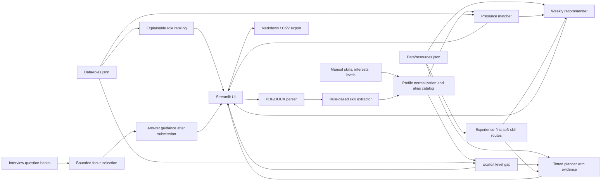

# Kiến trúc

## Thành phần

- **Parser:** `modules/cv_parser.py` đọc PDF/DOCX cục bộ, từ chối trên 10 MiB, giới hạn PDF ở 10 trang và trả metadata `page_truncated`/page counts. OCR chưa được cung cấp.
- **Extractor/Profile:** `modules/skill_extractor.py` nhận diện cụm từ trong catalog hữu hạn; `modules/profile.py` giữ kỹ năng chưa nhận diện và level khai báo riêng.
- **Matcher:** presence score dùng trọng số kỹ năng role; `compute_gap` dùng level 0–3 đã khai báo và đánh dấu thiếu level là `current=0` chỉ sau khi người dùng xác nhận ở UI.
- **Gợi ý role:** `suggest_roles` tính điểm heuristic theo skill/interests, hoàn toàn local; không dự đoán xác suất tuyển dụng.
- **Recommender:** weekly và timed dùng chung chính sách review; chỉ `reviewed`/`partial` được cân nhắc, partial phải hiện phạm vi, blocked/unsuitable/unreviewed bị loại. Lịch timed dùng thêm level range và duration có provenance; dữ liệu thiếu làm tổng tuần `null`.
- **Interview:** số câu bị chặn ở mức thấp hơn giữa 10 và số câu có trong ngân hàng của role. Câu hỏi được ưu tiên theo gap; sau submit chỉ hiển thị gợi ý và nguồn review (nếu có). Không có điểm tự động; ví dụ chưa review được gắn cảnh báo và tình huống không được coi là có một đáp án đúng.
- **Soft skills/traits:** roadmap thêm nhiệm vụ thực hành, phản hồi từ người quan sát và bằng chứng tự theo dõi; khóa học là tài liệu bổ trợ chứ không phải điều kiện hoàn thành.
- **Export:** `modules/export.py` tạo Markdown hoặc CSV, escape dữ liệu người dùng có thể trở thành công thức bảng tính, không xuất toàn văn CV.

Ứng dụng không thực hiện inference bằng mô hình AI trong bản này. Tên sản phẩm giữ “AI Career Coach”, còn mọi tính năng hiện có được mô tả theo thuật toán thực sự đang chạy.
