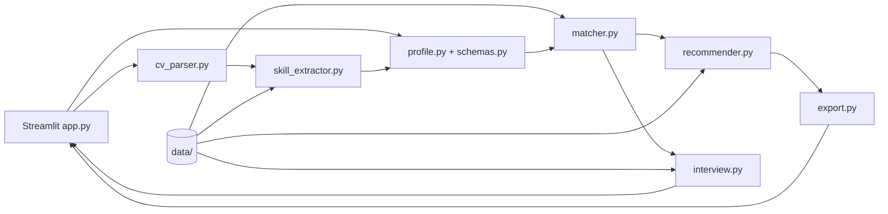

# Kiến trúc AI Career Coach

## Thành phần và hợp đồng

- `cv_parser.py` đọc PDF/DOCX, giới hạn 10 MiB và 10 trang PDF, trả `error_code` tường minh cho tệp hỏng, scan hoặc sai định dạng.
- `skill_extractor.py` chuẩn hóa Unicode, alias và level 0–3. CV dùng so khớp cụm từ có ranh giới; RapidFuzz hỗ trợ một số lỗi gõ gần đúng. Người dùng phải rà soát kết quả trích.
- `profile.py` gộp CV và dữ liệu nhập tay, giữ kỹ năng ngoài catalog, kiểm tra điều kiện nộp. `schemas.py` định nghĩa bốn hợp đồng Pydantic dùng ở biên profile, gap và phản hồi phỏng vấn.
- `matcher.py` tính presence theo trọng số role, gap theo level tự khai báo, đối chiếu JD và gợi ý role bằng 75% skill fit + 25% RIASEC. Skill fit dưới 15% làm điểm gợi ý bị giới hạn 5/100.
- `recommender.py` lọc nguồn theo trạng thái review, xây roadmap giai đoạn và lịch giờ/tuần. Khi thiếu thời lượng hoặc bằng chứng, tổng tuần được để chưa xác định.
- `interview.py` chọn câu theo role/gap, tối đa 10 câu và hiện gợi ý sau khi gửi. Ứng dụng không tự chấm câu trả lời.
- `export.py` tạo Markdown/CSV/JSON, escape ô CSV có thể bị hiểu là công thức và không xuất toàn văn CV.

## Phần AI

Bản hiện tại không tải mô hình AI, không gọi LLM/embedding API và không tự suy ra năng lực thực tế. RapidFuzz là thư viện so khớp chuỗi, RIASEC là vector sở thích có quy tắc, còn điểm role là heuristic. Các câu hỏi/rubric có thể được biên soạn với hỗ trợ AI nhưng metadata review trong dữ liệu quyết định cách hiển thị độ tin cậy; không xem đó là thẩm định chuyên gia.

## Dữ liệu và riêng tư

Các file runtime ở `data/`: 131 role, alias/catalog kỹ năng, 15 họ nghề RIASEC, học liệu, ba hồ sơ tổng hợp và 10 phần câu hỏi. CV nằm trong phiên xử lý Streamlit hiện tại; mã ứng dụng không ghi CV ra đĩa hay gửi API bên ngoài. Môi trường triển khai máy chủ cần chính sách lưu log và truy cập riêng.
