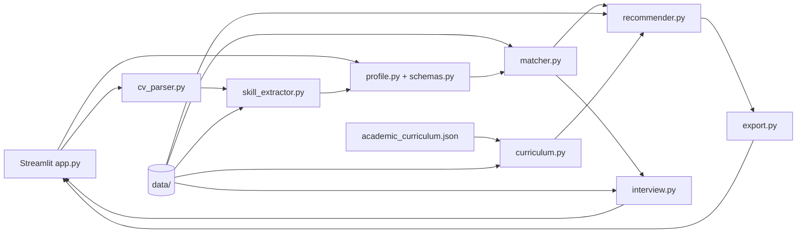

# Kiến trúc AI Career Coach

## Thành phần và hợp đồng

- `cv_parser.py` đọc PDF/DOCX, giới hạn 10 MiB và 10 trang PDF, trả `error_code` tường minh cho tệp hỏng, scan hoặc sai định dạng.
- `skill_extractor.py` chuẩn hóa Unicode, alias và level 0–3. CV dùng so khớp cụm từ có ranh giới; RapidFuzz hỗ trợ một số lỗi gõ gần đúng. Người dùng phải rà soát kết quả trích.
- `profile.py` gộp CV và dữ liệu nhập tay, giữ kỹ năng ngoài catalog, kiểm tra điều kiện nộp. `schemas.py` định nghĩa hợp đồng Pydantic dùng ở biên profile, gap và phản hồi phỏng vấn.
- `matcher.py` tính presence theo trọng số role, gap theo level tự khai báo, đối chiếu JD và gợi ý role bằng 75% skill fit + 25% RIASEC. Skill fit dưới 15% làm điểm gợi ý bị giới hạn 5/100.
- `curriculum.py` ghép lớp giáo trình/học liệu theo 410 kỹ năng của danh mục vị trí, giữ nguyên registry và lịch sử review cũ. `academic_curriculum.json` chứa nguồn, phạm vi, bài đọc, bài thực hành và đầu ra để xin phản hồi; `scripts/build_academic_curriculum.py` sinh lại mapping từ role catalog.
- `recommender.py` lọc nguồn theo trạng thái review, xây roadmap giai đoạn và lịch giờ/tuần. Nguồn học thuật nền tảng luôn đi cùng kế hoạch áp dụng; khi không có thời lượng có căn cứ, lộ trình tự học không gán số tuần.
- `interview.py` chọn câu theo role/gap, tối đa 10 câu và nhận xét câu trả lời theo rubric sau khi gửi. LLM được gọi khi có cấu hình; nếu thiếu key hoặc gặp lỗi, bộ chấm từ khóa offline trả kết quả tham khảo.
- `export.py` tạo Markdown/CSV/JSON, escape ô CSV có thể bị hiểu là công thức và không xuất toàn văn CV.

## Phần AI

LLM chỉ nằm ở nhánh nhận xét phỏng vấn. Hệ thống gửi nội dung câu hỏi, rubric, red flags và tối đa 3.000 ký tự câu trả lời tới endpoint OpenAI-compatible do người dùng cấu hình; không gửi CV, hồ sơ hay kỹ năng. Phản hồi LLM được kiểm tra cấu trúc và bằng chứng, còn điểm được code tính theo rubric. Mỗi lượt có tối đa hai request; hết 20 lượt LLM trong phiên hoặc khi dịch vụ lỗi thì dùng chấm từ khóa offline. Các phần còn lại vẫn dùng quy tắc: RapidFuzz hỗ trợ so khớp chuỗi, RIASEC là vector sở thích và điểm role là heuristic. Điểm phỏng vấn chỉ tham khảo, không suy ra năng lực thực tế. Metadata review của câu hỏi không phải thẩm định chuyên gia.

## Dữ liệu và riêng tư

Các file runtime ở `data/`: 131 role, alias/catalog kỹ năng, 15 họ nghề RIASEC, học liệu, ba hồ sơ tổng hợp và 10 phần câu hỏi. CV nằm trong phiên xử lý Streamlit hiện tại; mã ứng dụng không ghi CV ra đĩa hay gửi API bên ngoài. Môi trường triển khai máy chủ cần chính sách lưu log và truy cập riêng.
