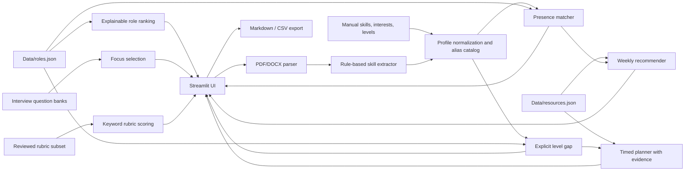

# Kiến trúc

## Thành phần

- **Parser:** `modules/cv_parser.py` đọc PDF/DOCX cục bộ, giữ lỗi có mã rõ ràng. OCR chưa được cung cấp.
- **Extractor/Profile:** `modules/skill_extractor.py` nhận diện cụm từ trong catalog hữu hạn; `modules/profile.py` giữ kỹ năng chưa nhận diện và level khai báo riêng.
- **Matcher:** presence score dùng trọng số kỹ năng role; `compute_gap` dùng level 0–3 đã khai báo và đánh dấu thiếu level là `current=0` chỉ sau khi người dùng xác nhận ở UI.
- **Gợi ý role:** `suggest_roles` tính điểm heuristic theo skill/interests, hoàn toàn local; không dự đoán xác suất tuyển dụng.
- **Recommender:** `build_roadmap` giữ API tuần cũ. `build_timed_roadmap` dùng metadata review, level range và duration có provenance; dữ liệu thiếu làm tổng tuần `null`.
- **Interview:** câu hỏi được ưu tiên theo gap. `score_answer` chỉ chấm rubric được review; phần còn lại trả unavailable. Phép chấm từ khóa không hiểu ngữ nghĩa đầy đủ.
- **Export:** `modules/export.py` tạo Markdown hoặc CSV, escape dữ liệu người dùng có thể trở thành công thức bảng tính, không xuất toàn văn CV.

Ứng dụng không thực hiện inference bằng mô hình AI trong bản này. Tên sản phẩm giữ “AI Career Coach”, còn mọi tính năng hiện có được mô tả theo thuật toán thực sự đang chạy.
